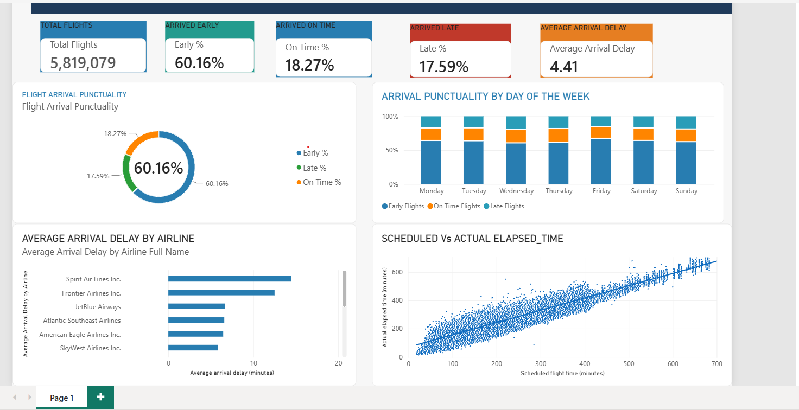

# Flight Performance & Arrival Punctuality Analysis

## Project Overview

This project uses Microsoft Power BI to analyse flight performance and arrival punctuality.

The dashboard provides an overview of flight punctuality, arrival delays, airline performance, and the relationship between scheduled and actual elapsed flight time.

## Objectives

The analysis aims to:

- Examine overall flight arrival punctuality
- Compare early, on-time and late flight performance
- Analyse punctuality patterns across different days of the week
- Compare average arrival delays across airlines
- Examine scheduled flight time compared with actual elapsed flight time

## Tools Used

- Microsoft Power BI
- Data Analysis
- Data Visualisation
- Dashboard Design
- KPI Reporting

## Dashboard

## Key Dashboard Metrics

The dashboard reports:

- **Total Flights:** 5,819,079
- **Arrived Early:** 60.16%
- **Arrived On Time:** 18.27%
- **Arrived Late:** 17.59%
- **Average Arrival Delay:** 4.41 minutes

## Analysis

### Flight Arrival Punctuality

The dashboard provides a breakdown of flights arriving early, on time and late.

### Punctuality by Day of the Week

The analysis compares arrival punctuality across Monday through Sunday to identify differences in flight performance during the week.

### Average Arrival Delay by Airline

The dashboard compares average arrival delays across airlines, allowing differences in airline-level performance to be identified.

### Scheduled vs Actual Elapsed Time

The scatter plot compares scheduled flight time with actual elapsed flight time and illustrates the relationship between the two measures.

## Skills Demonstrated

- Data analysis
- Data visualisation
- Power BI dashboard development
- KPI development
- Comparative analysis
- Interpreting trends and patterns
- Presenting data clearly for decision-making

## Project Purpose

This project demonstrates my ability to transform flight data into an interactive visual analysis and communicate findings through a Power BI dashboard.

**Author:** Elizabeth Sumbaei  
**GitHub:** https://github.com/lizsumbaei
